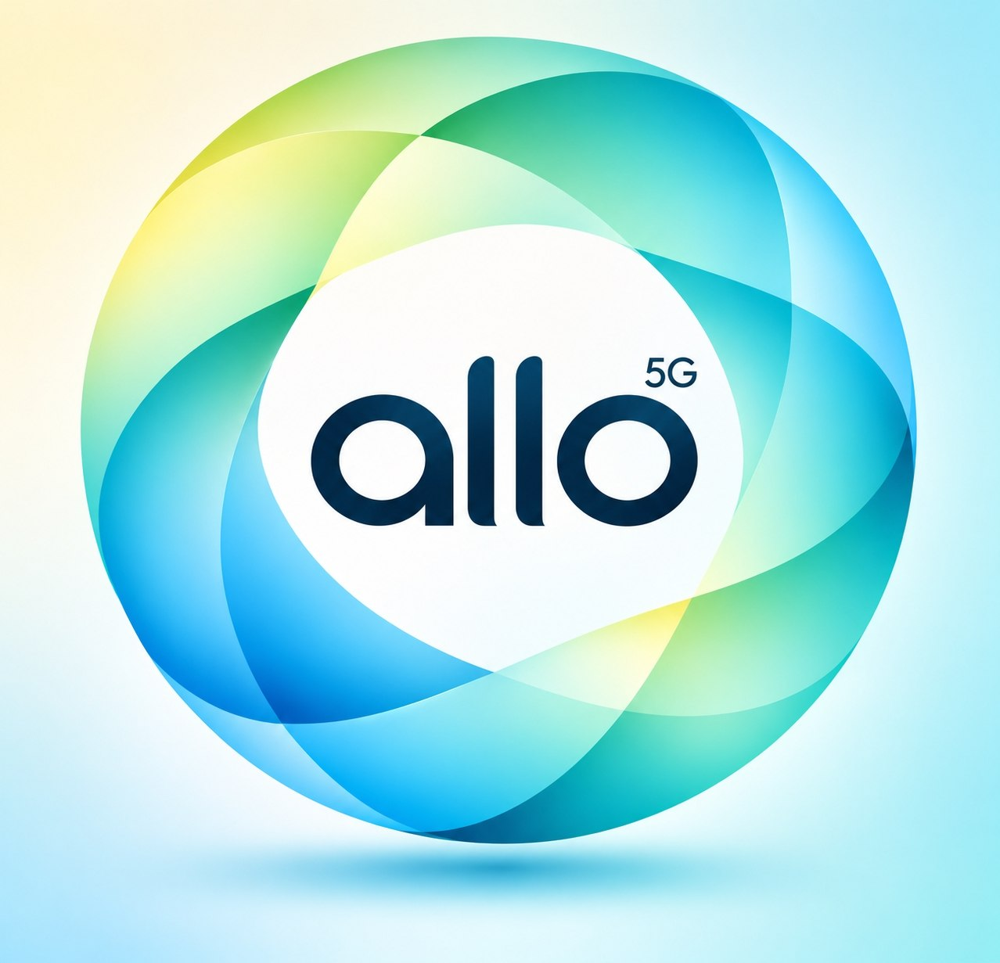

  

<h1 align="center">ALLO - الو</h1>

  <strong>A hands-on 5G Standalone, IMS voice, charging, and observability lab</strong>

  
  
  
  
  

ALLO is a local engineering environment for exploring a cloud-native 5G SA core and IMS voice service end to end. It combines Open5GS network functions on Kubernetes, UERANSIM radio and UE processes, Kamailio IMS with RTPEngine, lab-focused charging services, Prometheus-based telemetry, and the ALLO Control Center.

The project is designed for protocol integration, operations practice, service assurance, and revenue-workflow experimentation. The RAN is simulated; this is not a production mobile network or a production-grade 3GPP CHF/OCS implementation.

## Contents

- [At a glance](#at-a-glance)
- [Technology stack](#technology-stack)
- [Capabilities](#capabilities)
- [Architecture](#architecture)
- [End-to-end service chain](#end-to-end-service-chain)
- [Billing and charging](#billing-and-charging)
- [Roaming, QoS, VoNR, and subscribers](#roaming-qos-vonr-and-subscribers)
- [Monitoring and observability](#monitoring-and-observability)
- [Frontend: ALLO Control Center](#frontend-allo-control-center)
- [Install, deploy, and verify](#install-deploy-and-verify)
- [Endpoints and APIs](#endpoints-and-apis)
- [Repository map and documentation](#repository-map-and-documentation)
- [Scope and security](#scope-and-security)

## At a glance

| Area | What is in the repository |
| --- | --- |
| 5G SA core | Open5GS 2.8.0 manifests for home and visited AMF/SMF roles, UPF, NRF, AUSF, UDM, UDR, PCF, BSF, and MongoDB |
| Radio and UE simulation | Three UERANSIM gNodeB configurations and three UE configurations for two home PLMNs and one visited PLMN |
| IMS and voice | Kamailio P-, I-, and S-CSCF deployments, RTPEngine, SIP registration/call scripts, and G.711 PCMU media test paths |
| Charging | Erlang/OTP REST charging service, Python charging-server fallback, and a separate Python offline rating engine backed by SQLite |
| Observability | Telecom Prometheus exporter, Prometheus, Grafana dashboard provisioning, and Alertmanager rules |
| Operations UI | Python HTTP server and a browser-native HTML/CSS/JavaScript single-page application |
| Deployment | Kubernetes manifests, kind cluster configuration, UERANSIM configs, charging tariffs, and shell-based operational/verification scripts |

## Technology stack

Versions below come from image tags, lock/config files, or the repository's deployment guide. A component described as unpinned inherits its version from the external checkout or the Debian package repository at image-build time.

| Technology | Version / source | Role |
| --- | --- | --- |
| Open5GS | `gradiant/open5gs:2.8.0` | 5G core network functions |
| Kubernetes / kind | `kind` cluster defined in `k8s/kind-config.yaml`; the deployment guide uses kind `v0.24.0` | Local Kubernetes orchestration |
| Container runtime | Rootful Podman through the `podman-docker` CLI compatibility package in the documented RHEL setup | Builds and runs the kind node and local images |
| UERANSIM | Upstream checkout; the current development checkout is `v3.3.0-60-g4f45e18f`, but the main repository does not pin or vendor it | Simulated gNodeBs, UEs, NAS, NGAP, and GTP-U |
| IMS | Kamailio and RTPEngine packages installed into a Debian 12 based `ims-node` image; package versions are not pinned in the manifests | SIP signaling, registration, SDP control, and RTP relay |
| MongoDB | `mongo:8.0` | Open5GS subscriber data store |
| Charging API | Erlang/OTP `25` or later per the project guide; Cowboy `2.10.0`, JSX `3.1.0` | Concurrent charging API, balance lifecycle, and reconciliation |
| Python services | Python `3.10+` per the project guide | GUI/API server, exporter, charging fallback, offline rating and operations |
| Offline charging store | SQLite 3 with WAL mode | Persistent Python usage-rating database at `data/charging.sqlite` |
| Monitoring | Prometheus `v2.45.0`, Grafana `10.4.0`, Alertmanager `v0.25.0` | Scraping, dashboards, and alert delivery |
| Frontend | Native HTML, CSS, and JavaScript served by Python; no npm build step is used by the GUI runner | ALLO Control Center |

The root package.json declares React, React DOM, XYFlow, and related JavaScript dependencies, but it defines no build scripts and the current Control Center does not import them. They are not required to run the checked-in frontend.

## Capabilities

- **5G SA registration and sessions:** SIM profiles are provisioned into MongoDB; UEs register through the simulated RAN and request `internet` and `ims` DNN sessions on S-NSSAI SST 1.
- **Separated home and visited access:** Home gNodeBs serve PLMNs `602/03` and `602/04`; a separate visited gNodeB serves `218/90`.
- **IMS registration and voice:** Kamailio handles SIP registration and session routing. RTPEngine rewrites SDP and relays RTP media.
- **Roaming lab flow:** UE3 retains a home identity in `602/03`, attaches through the visited `218/90` RAN/core path, and uses the configured local-breakout route.
- **Charging and revenue assurance:** Configurable voice/data tariffs, prepaid balance operations, usage rating, transaction history, and reconciliation.
- **Operational visibility:** Prometheus metrics cover infrastructure, core, IMS, RTP, usage, QoE, and roaming domains; Grafana dashboards and Alertmanager rules are provisioned as Kubernetes resources.
- **Control Center:** Overview, subscribers, IMS traffic, billing, topology, and Admin NOC views backed by the project's API endpoints.
- **Repeatable operations:** Scripts provision subscribers, start services, trigger IMS calls, collect/rate usage, and verify the running lab.

## Architecture

The following view reflects the checked-in Kubernetes manifests and current UERANSIM configurations. The home and visited SMFs currently use one shared Open5GS UPF deployment; there is not a separate V-UPF pod.

~~~mermaid
flowchart LR
    subgraph RAN["Host processes — UERANSIM"]
        UE1["UE1 Home PLMN 602/03"]
        UE2["UE2 Home PLMN 602/04"]
        UE3["UE3 HPLMN 602/03"]
        GNBH["gNodeB-Home N2 :38412"]
        GNBH2["gNodeB-Home2 N2 :38412"]
        GNBV["gNodeB-Visited PLMN 218/90 N2 :38413"]
        UE1 --> GNBH
        UE2 --> GNBH2
        UE3 --> GNBV
    end

    subgraph KIND["kind cluster — node 172.19.0.2"]
        subgraph CORE["open5gs namespace"]
            HAMF["Home AMF"]
            VAMF["Visited AMF"]
            HSMF["Home SMF"]
            VSMF["Visited SMF"]
            UPF["Open5GS UPF ogstun / N3 / N4"]
            NRF["NRF"]
            AUSF["AUSF"]
            UDM["UDM / UDR"]
            PCF["PCF / BSF"]
            DB[("MongoDB subscriber profiles")]
            HAMF --> HSMF
            VAMF --> VSMF
            HSMF -->|"N4 PFCP"| UPF
            VSMF -->|"N4 PFCP"| UPF
            VAMF -. "N12 home authentication" .-> AUSF
            AUSF --> UDM --> DB
            NRF --- HAMF
            NRF --- VAMF
            NRF --- HSMF
            NRF --- VSMF
            HSMF --> PCF
            VSMF --> PCF
        end

        subgraph IMS["ims namespace"]
            PCSCF["Kamailio P-CSCF SIP :5060"]
            ICSCF["Kamailio I-CSCF"]
            SCSCF["Kamailio S-CSCF registrar / CDR"]
            RTP["RTPEngine NG :22222 / RTP relay"]
            PCSCF --> ICSCF --> SCSCF
            PCSCF <-->|"NG control"| RTP
        end

        subgraph OBS["monitoring namespace"]
            EXP["Telecom exporter :9100"]
            PROM["Prometheus :9090"]
            GRAF["Grafana :3000"]
            ALERT["Alertmanager :9093"]
            EXP --> PROM
            PROM --> GRAF
            PROM --> ALERT
        end

        UPF -->|"IMS DNN"| PCSCF
        UPF -->|"Internet DNN / N6"| INTERNET["Data network / host routing"]
    end

    GNBH -->|"N2 NGAP / SCTP"| HAMF
    GNBH2 -->|"N2 NGAP / SCTP"| HAMF
    GNBV -->|"N2 NGAP / SCTP"| VAMF
    GNBH -->|"N3 GTP-U"| UPF
    GNBH2 -->|"N3 GTP-U"| UPF
    GNBV -->|"N3 GTP-U"| UPF
    PCSCF -. "SIP signaling over IMS PDU session" .-> UE1
    PCSCF -. "SIP signaling over IMS PDU session" .-> UE2
    PCSCF -. "SIP signaling over IMS PDU session" .-> UE3
    UE1 <-->|"RTP via RTPEngine"| RTP
    UE2 <-->|"RTP via RTPEngine"| RTP
    UE3 <-->|"RTP via RTPEngine"| RTP
~~~

The cluster is defined by `k8s/kind-config.yaml`; core, IMS, and monitoring resources are deployed in the `open5gs`, `ims`, and `monitoring` namespaces. UERANSIM runs on the Linux host and communicates with the kind node over the configured `172.19.0.0/16` network.

## End-to-end service chain

~~~mermaid
sequenceDiagram
    autonumber
    participant UE1 as Caller UERANSIM UE
    participant UE2 as Callee UERANSIM UE
    participant GNB as Home / visited gNodeB
    participant AMF as Open5GS AMF
    participant SMF as Open5GS SMF
    participant UPF as Shared Open5GS UPF
    participant P as Kamailio P-CSCF
    participant I as Kamailio I-CSCF
    participant S as Kamailio S-CSCF
    participant RTP as RTPEngine
    participant TEST as Call / usage script
    participant CHG as Charging API
    participant CDR as S-CSCF SQLite CDR

    UE1->>GNB: Simulated NR access
    UE2->>GNB: Simulated NR access
    GNB->>AMF: N2 NGAP over SCTP
    AMF->>SMF: 5G core service-based control
    SMF->>UPF: N4 PFCP session programming
    GNB->>UPF: N3 GTP-U user plane
    UE1->>P: IMS PDU session; SIP REGISTER
    P->>I: Route registration / session
    I->>S: Resolve subscriber and registrar state
    S-->>UE1: SIP Digest challenge and registration response
    UE1->>P: SIP INVITE with SDP offer
    P->>I: Forward SIP dialog
    I->>S: Route within IMS domain
    S->>P: Route to registered callee
    P->>UE2: SIP INVITE
    UE2-->>P: 180 Ringing, then 200 OK with SDP answer
    P->>RTP: RTPEngine offer / answer control
    RTP-->>P: Rewritten SDP
    UE1->>RTP: G.711 PCMU RTP media
    RTP->>UE2: Relayed RTP media
    UE2->>RTP: Return RTP media
    RTP->>UE1: Relayed RTP media
    UE1->>P: SIP BYE
    S->>CDR: Store completed dialog CDR
    TEST->>CHG: POST completed call usage to /v1/charging/events
~~~

A successful call exercises both the 5G user plane and IMS signaling: SIP uses the UE's `ims` PDU session, while SDP negotiation directs media through RTPEngine. The call and usage scripts collect signaling, media, and billing evidence from the active lab rather than from a generated dashboard fixture.

## Billing and charging

ALLO contains two related lab charging paths:

1. **Charging REST service (`:8085`)** — `scripts/run-erlang-charging.sh` starts the Erlang/OTP service when Erlang and rebar3 are installed. Otherwise it starts `services/charging-server.py` as a Python-compatible service. Both expose the charging API used by the Control Center and call scripts.
2. **Offline rating engine** — `scripts/rating-engine.py` reads completed Kamailio SQLite CDRs and available UE network-interface counters, applies YAML rate-plan/tariff rules, and stores its rated usage and transaction data in `data/charging.sqlite`.

~~~mermaid
flowchart LR
    CDR["Kamailio S-CSCF completed dialog CDRs"]
    NETNS["UE Linux namespaces interface byte counters"]
    PY["Python offline rating scripts/rating-engine.py"]
    SQLITE[("SQLite data/charging.sqlite")]
    GUI["ALLO Control Center and call scripts"]
    API["Charging HTTP API :8085 Erlang/OTP or Python fallback"]
    TARIFF["YAML rate plans and tariffs"]
    AUDIT["Reconciliation and transaction reports"]

    CDR --> PY
    NETNS --> PY
    TARIFF --> PY
    PY --> SQLITE
    GUI --> API --> AUDIT
~~~

Tariff selection uses service type, destination classification (domestic or `roaming_vplmn`), rate plan, and—for data—DNN. Voice rules support setup charges, minimum billable time, and ceiling increments; data rules use byte quantities and configured granularity. The configured currency label is `LAB`.

The charging model demonstrates reservations, consumption, refunds/releases, idempotent references, and account reconciliation. The Python offline database is persistent SQLite; the Erlang service initializes its own in-process state from configured defaults. Do not assume every endpoint uses the same persistence store.

This is an engineering and rating demonstration, **not** a 3GPP Online Charging System or 5G CHF implementation: Nchf charging integration is not present.

## Roaming, QoS, VoNR, and subscribers

### Roaming

The configured subscriber/RAN scenarios are:

| UE | Home PLMN | Serving PLMN | Access path |
| --- | --- | --- | --- |
| UE1 | `602/03` | `602/03` | Home RAN and Home AMF |
| UE2 | `602/04` | `602/04` | Home2 RAN and Home AMF |
| UE3 | `602/03` | `218/90` | Visited RAN and Visited AMF/SMF |

For UE3, the visited AMF requests home authentication through the Open5GS service-based core path, while the visited SMF provides the visited session-control path. Both SMFs currently program the shared UPF instance. This is a lab local-breakout scenario; the manifests do not deploy SEPP/N32 protection or a separate visited UPF, and home-routed roaming over N9/N16 is not implemented.

### QoS

The UPF startup command configures a Linux `tc` priority qdisc on `ogstun`, with filters for SIP port 5060 and selected IP ToS/DSCP values. This is host-level traffic classification for the lab; it is not a claim of a fully provisioned end-to-end 5QI QoS policy.

### VoNR / IMS voice

The lab demonstrates simulated IMS voice over 5G PDU sessions. Kamailio handles P-/I-/S-CSCF signaling and registration, and RTPEngine handles SDP rewriting and RTP relay. The call flow uses SIP Digest authentication and G.711 PCMU media. It is an emulated UE/RAN/core environment, not a connection to commercial radio equipment.

### Subscriber management

- `scripts/add-subscriber.sh` provisions the test subscriber profiles into the Open5GS MongoDB store.
- UERANSIM UE configurations provide the corresponding test identities and authentication material; the UERANSIM checkout and binaries are external to the tracked repository.
- IMS registration credentials are configured for the lab S-CSCF and stored separately from Open5GS subscription profiles.
- The Control Center reads subscriber, charging, CDR, and network information from the backend APIs and configured local telemetry sources.

## Monitoring and observability

Prometheus scrapes the telecom exporter and Prometheus itself on a **5-second** scrape/evaluation interval. The exporter is packaged into the local `ims-node` image and exposes `/metrics` on port `9100`.

The metric families cover:

- Kubernetes pod readiness and restart state.
- Open5GS NF status, registered UEs, PDU sessions, N2 associations, PFCP status, and GTP-U counters.
- Kamailio SIP status, registration state, request counters, and dialogs.
- RTPEngine availability, sessions, relay packets/bytes, and errors.
- CDR counts and call duration.
- Service assurance metrics such as PDD, CST, CSSR, packet loss, jitter, R-factor, and estimated MOS.
- Roaming attachment, local-breakout state, and inter-PLMN call metrics.
- Charging balances, transaction totals, usage, and reconciliation signals where exported.

Grafana dashboards and Prometheus alert rules are provisioned from Kubernetes ConfigMaps; Alertmanager is exposed separately for alert inspection.

Telemetry sources are mixed and should be interpreted per metric. Pod readiness, Kamailio registrations/CDRs, RTPEngine probe/statistics, and UE/UPF interface counters are collected from runtime queries. Some fixed-topology gauges (including UE/PDU and N2/PFCP states), roaming indicators, charging account/reconciliation values, and QoE fallback values are supplied as scenario defaults or derived in exporter code; revenue is calculated from CDR totals and configured rates rather than read from the Erlang ledger. See the [exporter source](scripts/telecom-exporter.py) and [metrics source map](docs/observability/metrics-source-map.md) before treating a panel as a direct measurement.

### Grafana dashboard

*Grafana operations overview. The values shown are a captured lab state; dashboard values vary with current Prometheus data.*

### Voice and revenue telemetry

*Telemetry panels include voice-quality indicators, recorded call activity, cumulative call duration, and roaming status.*

## Frontend: ALLO Control Center

The Control Center is a Python-served single-page application with responsive HTML, CSS, and JavaScript. Its views include Overview, Subscribers, IMS & Traffic, Billing & Charging, Network Topology, and Admin NOC. The API aggregates available local, Kubernetes, Prometheus, and charging-service sources; each value inherits the freshness and fallback behavior of its source. The screenshots below are representative captures, not static metrics used by the application.

### Overview

*Overview and service-chain view captured on 12 November 2026. Counts and balances shown are time-specific and depend on the lab state.*

### IMS calls and traffic

*The IMS view exposes call controls and recorded CDR fields. RTP telemetry is shown when the running service provides it.*

### Billing and charging

*Billing view showing the configured tariff matrix, account balance data, and reconciliation status for the captured session.*

The Overview cards, call and revenue visualizations, network-function rows, and service-chain components link to technical drilldowns. Admin NOC links expose health and management functions already available in the application. The GUI does not add a separate identity or role provider.

## Install, deploy, and verify

The checked-in bootstrap targets a Linux host using rootful Podman through the Docker-compatible CLI, `kind`, and `kubectl`. The existing deployment guide documents RHEL 10.x. The scripts also configure host IP forwarding/reverse-path filtering and use the `172.19.0.0/16` kind network. Review these host-level requirements before running on a shared machine.

### Laptop or workstation requirements

The repository does not define or validate minimum CPU, memory, or disk capacity. For planning a local all-in-one lab, use a modern **x86_64 Linux** laptop or PC with **4 or more CPU cores, 16 GB RAM, and about 30 GB of free disk space** as a practical starting point; these are recommendations, not measured minimums or a performance guarantee. More headroom helps because the host builds UERANSIM and an IMS image while running a single-node Kubernetes cluster with the 5G core, IMS, and monitoring workloads.

The verified platform requirements are Linux with root/sudo access, a working SCTP kernel module, `/dev/net/tun`, IPv4 forwarding, and the ability to create a Podman network on `172.19.0.0/16`. The documented RHEL 10.2 setup uses rootful Podman plus `podman-docker`; Docker-compatible CLI support, `kind`, and `kubectl` are needed by the bootstrap. Internet access is needed to fetch UERANSIM, download tools, and pull/build container images. Physical radio hardware is not required: UERANSIM supplies the simulated gNodeBs and UEs.

Before the first run, confirm TUN exists and load SCTP for NGAP. The bootstrap script sets IPv4 forwarding and reverse-path filtering at runtime:

~~~bash
test -c /dev/net/tun
sudo modprobe sctp
~~~

The supplied RHEL runbook temporarily changed SELinux/firewall settings on its own lab host. Those are not universal project prerequisites; do not persist permissive SELinux or disable the firewall by default. If host firewall policy blocks the lab, allow only the needed lab traffic under the local security policy (including SCTP 38412/38413 and UDP 2152/8805).

### Prerequisites

- Linux with root access for kernel networking, SCTP, gNodeB and UE TUN/network-namespace setup.
- Podman and `podman-docker` (or a compatible Docker CLI/runtime), kind, and kubectl.
- Python 3.10+, `jq`, `curl`, SQLite, `iproute2`, iptables, SCTP tools, CMake, a C++ compiler, and `make`.
- Erlang/OTP 25+ and rebar3 for the Erlang charging service. If they are absent, the launcher uses the Python charging-server implementation.
- A UERANSIM source tree and built binaries. The main repository ignores `UERANSIM/`; the commands below fetch the upstream revision used by the current local development checkout and apply the repository roaming extension.
- Internet connectivity for container image pulls and Debian package installation during the `ims-node` image build.

### Install host tools on the documented RHEL-family setup

The package names below follow the repository's Podman/RHEL runbook. The binary download commands target x86_64, as in that setup; install compatible kind and kubectl binaries if they are not already available:

~~~bash
sudo dnf install -y python3 python3-pip git sqlite jq curl \
  lksctp-tools lksctp-tools-devel iproute iptables-nft \
  gcc gcc-c++ make cmake podman podman-docker

curl -fL --retry 5 -o /tmp/kind \
  https://github.com/kubernetes-sigs/kind/releases/download/v0.24.0/kind-linux-amd64
sudo install /tmp/kind /usr/local/bin/kind
rm -f /tmp/kind

KVER=$(curl -fsSL --retry 5 https://dl.k8s.io/release/stable.txt)
curl -fL --retry 5 -o /tmp/kubectl \
  "https://dl.k8s.io/release/\${KVER}/bin/linux/amd64/kubectl"
sudo install /tmp/kubectl /usr/local/bin/kubectl
rm -f /tmp/kubectl
~~~

Erlang/OTP and rebar3 are optional because the charging launcher falls back to Python. For the Erlang implementation, install OTP 25+ and rebar3 using the host's supported package method; package-manager instructions may differ by distribution.

### 1. Build UERANSIM

Run from the repository root. The checkout is ignored by this repository and is not included in a normal ALLO clone.

~~~bash
git clone https://github.com/aligungr/UERANSIM.git UERANSIM
cd UERANSIM
git checkout 4f45e18f80b0684f7d6e29f1fea0f579e9243d68
git apply ../configs/ueransim/vplmn.patch
make -j"$(nproc)"
cd ..
~~~

### 2. Build the local IMS/exporter image

The Kubernetes manifests reference `ims-node:latest` for Kamailio, RTPEngine, and the telecom exporter. Build it in the rootful Podman image store used by the kind setup:

~~~bash
sudo podman build -t ims-node:latest -f - . <<'EOF'
FROM debian:12-slim
ENV DEBIAN_FRONTEND=noninteractive
RUN apt-get update && apt-get install -y --no-install-recommends \
    kamailio kamailio-sqlite-modules kamailio-extra-modules \
    kamailio-utils-modules kamailio-presence-modules \
    rtpengine python3 bash iproute2 iptables procps ca-certificates curl \
    && rm -rf /var/lib/apt/lists/*
EOF
~~~

The bootstrap script attempts to preload locally available images into kind. Open5GS is referenced by the manifests as `gradiant/open5gs:2.8.0`; MongoDB is `mongo:8.0`.

### 3. Start the charging service and Kubernetes workloads

On the documented rootful Podman setup, create the bridge network expected by the fixed node address if it does not already exist, then start charging and bootstrap the cluster. `KUBECONFIG` is set explicitly because the guide's cluster was created as root:

~~~bash
sudo podman network inspect kind >/dev/null 2>&1 || \
  sudo podman network create kind --subnet 172.19.0.0/16 --gateway 172.19.0.1

bash scripts/run-erlang-charging.sh start
sudo env KIND_EXPERIMENTAL_PROVIDER=podman KUBECONFIG=/root/.kube/config \
  bash scripts/start-lab.sh
~~~

`start-lab.sh` creates/starts the `open5gs-cluster`, applies the Open5GS, IMS, and monitoring manifests, waits for workloads, and provisions subscriber profiles. It uses the rootful Docker-compatible CLI and the selected `KUBECONFIG`.

#### RHEL 10.2 / Podman image-loading note

The supplied RHEL 10.2 runbook reports that `start-lab.sh` can time out waiting for IMS because its `kind load docker-image` attempt does not place the local `ims-node` image in the cluster. If that happens, the runbook's recovery is to export and load an image archive, restart the IMS and exporter deployments, then finish subscriber provisioning. Prepare the archive after building the image above:

~~~bash
sudo podman tag ims-node:latest docker.io/library/ims-node:latest
sudo podman save docker.io/library/ims-node:latest -o /tmp/ims-node.tar

sudo env KIND_EXPERIMENTAL_PROVIDER=podman KUBECONFIG=/root/.kube/config \
  kind load image-archive /tmp/ims-node.tar --name open5gs-cluster
sudo env KUBECONFIG=/root/.kube/config kubectl -n ims rollout restart deploy
sudo env KUBECONFIG=/root/.kube/config \
  kubectl -n monitoring rollout restart deploy/telecom-exporter
sudo env KUBECONFIG=/root/.kube/config kubectl get pods -A
sudo env KUBECONFIG=/root/.kube/config bash scripts/add-subscriber.sh all
~~~

This is a workaround reported for that RHEL/Podman run, not a universal requirement. Once a cluster already exists, do not blindly rerun `start-lab.sh` on the reported setup: the runbook observed Podman/kind cluster detection fail and an attempted duplicate cluster creation. Check `kind get clusters` and pod status first. See [Platform operations runbook](docs/OPERATIONS.md) for the general sequence.

### 4. Start the radio, subscribers, and GUI

~~~bash
sudo bash scripts/run-gnb.sh all
sudo bash scripts/run-ue.sh all
bash scripts/run-gui.sh start
~~~

The `all` targets start the three configured gNodeBs and UE1/UE2/UE3. Wait for registration and PDU establishment in the UE logs before testing IMS calls.

### Quick start after prerequisites and image builds

For a repeat startup after the host tools, UERANSIM binaries, IMS image, and cluster are ready, use this order:

~~~bash
bash scripts/run-erlang-charging.sh start
sudo bash scripts/run-gnb.sh all
sudo bash scripts/run-ue.sh all
bash scripts/run-gui.sh start
~~~

Open the Control Center at `http://127.0.0.1:8088`. The GUI and charging service run as the current user; gNodeBs and UEs need root for host networking and TUN namespaces. The cluster itself must already be running. For first-time setup, follow the numbered bootstrap steps above; a real reboot may require starting the Podman kind node and rechecking pods before launching the RAN.

### 5. Verify

Read-only health checks:

~~~bash
curl -fsS http://127.0.0.1:8085/health
curl -fsS http://127.0.0.1:8088/api/system/health
sudo env KUBECONFIG=/root/.kube/config kubectl get pods -A
~~~

Run the full end-to-end suite against an active lab:

~~~bash
sudo bash scripts/verify-lab.sh
~~~

The lab suite exercises live core, RAN, IMS, and service paths; it can generate SIP calls, CDRs, telemetry, and charging activity. Additional subsystem checks are available as `scripts/verify-gui.sh`, `scripts/verify-rating.sh`, `scripts/verify-erlang-charging.sh`, `scripts/verify-observability.sh`, `scripts/verify-alerting.sh`, and `scripts/verify-grafana.sh`. The Erlang EUnit suite is run with `cd services/charging-erlang && rebar3 eunit`.

## Endpoints and APIs

The following ports are configured by the repository. `172.19.0.2` is the kind node address used by this lab; reachability from the host depends on the Podman network setup.

| Service | Endpoint | Purpose |
| --- | --- | --- |
| ALLO Control Center | `http://127.0.0.1:8088` | Overview and operations UI |
| Control Center API | `http://127.0.0.1:8088/api/...` | Aggregated health, subscribers, calls, charging, and topology data |
| Charging REST API | `http://127.0.0.1:8085` | Health, accounts, tariffs, rating, charging events, and reconciliation |
| Prometheus | `http://172.19.0.2:30090` | Metrics query and target status |
| Grafana | `http://172.19.0.2:30300` | Provisioned telecom dashboard |
| Alertmanager | `http://172.19.0.2:30093` | Alert inspection |
| Telecom exporter | `http://172.19.0.2:9100/metrics` | Prometheus exposition endpoint |
| Home / visited AMF N2 | `172.19.0.2:38412` / `172.19.0.2:38413` | NGAP over SCTP |
| UPF N3 / N4 | `172.19.0.2:2152` / `172.19.0.2:8805` | GTP-U / PFCP over UDP |
| IMS P-CSCF | `10.46.0.1:5060` | SIP ingress on the IMS data path |
| RTPEngine | `10.46.0.1:22222` | NG control over UDP; RTP relay ports are configured separately |

### Control Center API surface

The GUI server exposes these current routes:

- **GET** `/api/overview`, `/api/subscribers`, `/api/calls`
- **GET** `/api/charging/overview`, `/api/charging/accounts`, `/api/charging/tariffs`, `/api/charging/transactions`, `/api/charging/reconciliation`
- **GET** `/api/network/topology`, `/api/system/health`, `/api/actions/call-status`
- **POST** `/api/actions/trigger-call`, `/api/actions/start-call`, `/api/actions/hangup-call`
- **POST** `/api/actions/topup`, `/api/actions/recharge`, `/api/actions/quote`, `/api/actions/reconcile`, `/api/actions/measure-kpis`

## Repository map and documentation

~~~text
ALLO/
├── configs/
│   ├── charging/              # YAML accounts, rate plans, tariffs
│   └── ueransim/              # 3 gNodeB configs, UE configs, roaming patch
├── data/                      # Local SQLite charging DB; generated and git-ignored
├── docs/
│   ├── architecture/          # 5G SA / IMS topology and home/visited RAN
│   ├── charging/              # Rating model, ledger, Erlang API and operations
│   ├── observability/         # Exporter, metrics, Grafana, Prometheus, alerting
│   ├── engineering-notes/     # Network and PDU-session troubleshooting
│   └── OPERATIONS.md          # Deployment and lab runbook
├── k8s/
│   ├── ims/                   # Kamailio and RTPEngine manifests
│   ├── monitoring/            # Exporter, Prometheus, Grafana, Alertmanager
│   └── *.yaml                 # kind-facing Open5GS core and MongoDB resources
├── scripts/                   # Bootstrap, launch, call, rating and verification tools
├── services/
│   ├── charging-erlang/       # Erlang/OTP charging application and EUnit tests
│   ├── charging-server.py     # Python charging API fallback
│   └── telecom-gui/           # Python API server and static frontend
├── src/charging/              # Python offline rating, balance, database and audit
└── README.md
~~~

Further reading:

- [Platform operations runbook](docs/OPERATIONS.md)
- [Documentation index](docs/README.md)
- [5G SA and IMS architecture](docs/architecture/README.md)
- [Current home/visited RAN note](docs/architecture/home-vs-visited-ran.md)
- [IMS call-flow validation](docs/IMS-CALL-FLOW-VALIDATION.md)
- [IMS Kubernetes manifests](k8s/ims/README.md)
- [Charging architecture](docs/charging/architecture.md)
- [Charging rating model and tariff rules](docs/charging/rating-model.md)
- [Balance lifecycle and transaction journal](docs/charging/balance-management.md)
- [Erlang charging REST API](docs/charging/erlang-api.md)
- [Python charging data model](docs/charging/data-model.md)
- [Charging reconciliation](docs/charging/reconciliation.md)
- [Observability architecture](docs/observability/observability-architecture.md)
- [Prometheus deployment](docs/observability/prometheus-deployment.md)
- [Grafana operations dashboard](docs/observability/grafana-operations-dashboard.md)
- [Alerting rules and runbooks](docs/observability/alerting.md)
- [Contribution guide](CONTRIBUTING.md)
- [Security policy](SECURITY.md)

## Scope and security

- ALLO is a simulated lab: UERANSIM is not physical radio hardware, and the platform does not implement a complete operator roaming security boundary.
- The checked-in manifests use lab credentials and configure Grafana anonymous access with the `Admin` role. The Control Center has no independent authentication or role system, and its server defaults to listening on `0.0.0.0`.
- Keep management ports on a trusted lab network. Review and replace demo credentials and access settings before exposing any service beyond that environment.
