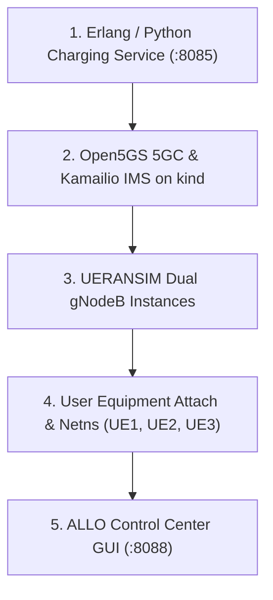

# ALLO - الو — Platform Operations & Runbook

This runbook covers the end-to-end lifecycle, day-to-day operations, testing, and troubleshooting for the **ALLO - الو** 5G Telecom Engineering Platform.

---

## 1. Quick Reference & System Topology

### Network Endpoints & Ports

| Subsystem | Service / Role | Host Endpoint | Namespace / Container | Protocol |
| :--- | :--- | :--- | :--- | :--- |
| **Control Center** | ALLO Web GUI | `http://127.0.0.1:8088` | Host daemon | HTTP |
| **BSS Charging** | Erlang/OTP Cowboy REST API | `http://127.0.0.1:8085` | Host daemon | HTTP |
| **Observability** | Prometheus Server | `http://172.19.0.2:30090` | K8s: `monitoring` | HTTP |
| **Observability** | Grafana Dashboards | `http://172.19.0.2:30300` | K8s: `monitoring` (admin/admin) | HTTP |
| **Observability** | Alertmanager | `http://172.19.0.2:30093` | K8s: `monitoring` | HTTP |
| **Observability** | Telecom Metrics Exporter | `http://172.19.0.2:9100/metrics` | K8s: `monitoring` | HTTP |
| **5G Core** | Home AMF (N2 NGAP) | `172.19.0.2:38412` | K8s: `open5gs` | SCTP |
| **5G Core** | Visited AMF (N2 NGAP) | `172.19.0.2:38413` | K8s: `open5gs` | SCTP |
| **5G Core** | UPF (N3 GTP-U) | `172.19.0.2:2152` | K8s: `open5gs` (`hostNetwork`) | UDP |
| **5G Core** | UPF (N4 PFCP) | `172.19.0.2:8805` | K8s: `open5gs` (`hostNetwork`) | UDP |
| **5G Core** | Subscriber Store | `172.19.0.2:27017` | K8s: `open5gs` (MongoDB) | TCP |
| **IMS Core** | Kamailio P-CSCF (SIP Proxy) | `10.46.0.1:5060` | K8s: `ims` (`hostNetwork`) | SIP / UDP |
| **IMS Core** | RTPEngine (NG Control) | `10.46.0.1:22222` | K8s: `ims` (`hostNetwork`) | UDP |
| **IMS Core** | RTPEngine (Media Relay) | `10.46.0.1:20000–20100`| K8s: `ims` (`hostNetwork`) | RTP / UDP |

### Subscriber & Roaming Matrix

| UE | Subscriber Identity | Home PLMN | Serving PLMN | Mode | Internet IP | IMS IP | SIP Contact | Rate Plan |
| :--- | :--- | :--- | :--- | :--- | :--- | :--- | :--- | :--- |
| **UE1** | `602030000000001` | `602/03` (Egypt) | `602/03` (Egypt) | Domestic | `10.45.0.10` | `10.46.0.10` | `sip:ue1@ims.lab` | `standard-prepaid` |
| **UE2** | `602040000000002` | `602/04` (Egypt) | `602/04` (Egypt) | Domestic | `10.45.0.11` | `10.46.0.11` | `sip:ue2@ims.lab` | `standard-prepaid` |
| **UE3** | `602030000000003` | `602/03` (Egypt) | `218/90` (Bosnia)| Roaming (LBO) | `10.45.0.100`| `10.46.0.100`| `sip:ue3@ims.lab` | `premium-roaming` |

---

## 2. Prerequisites & Environment Setup

### 2.1 Host System Dependencies

| Component | Required Version | Verification Command |
| :--- | :--- | :--- |
| **Linux OS** | Ubuntu 22.04+ / RHEL 10+ / Debian 12+ | `uname -r` |
| **Docker or Podman** | Docker 20.10+ / Podman 4.5+ | `docker version` or `podman version` |
| **kind** | v0.20.0+ | `kind version` |
| **kubectl** | v1.28.0+ | `kubectl version --client` |
| **Python** | 3.10+ | `python3 --version` |
| **UERANSIM** | v3.3.0 (`nr-gnb`, `nr-ue`) | `which nr-gnb nr-ue` |
| **Erlang/OTP** | OTP 25+ | `erl -eval 'erlang:display(erlang:system_info(otp_release)), halt().' -noshell` |
| **rebar3** | 3.22+ | `rebar3 --version` |

### 2.2 Host Kernel Networking Parameters

UERANSIM network namespaces and Open5GS Local Breakout require Linux kernel IP forwarding, relaxed reverse-path filtering, and SCTP kernel support:

```bash
# Enable IPv4 forwarding and disable strict RP filtering
sudo sysctl -w net.ipv4.ip_forward=1
sudo sysctl -w net.ipv4.conf.all.rp_filter=0
sudo sysctl -w net.ipv4.conf.default.rp_filter=0

# Ensure SCTP kernel module is loaded for N2 NGAP
sudo modprobe sctp
```

---

## 3. Step-by-Step Platform Startup

Start the subsystems in the following deterministic sequence:



### Step 1: Start the Revenue & Charging Engine (:8085)

The charging service provides real-time prepaid rating, multi-bucket account balance management, and immutable double-entry ledger bookkeeping.

```bash
# Start Erlang/OTP charging daemon
bash scripts/run-erlang-charging.sh start

# Verify charging service health
curl -s http://127.0.0.1:8085/health | jq .
```

*Expected output:*
```json
{
  "status": "UP",
  "service": "charging-erlang",
  "version": "1.0.0",
  "otp_release": "25"
}
```

> [!NOTE]
> If Erlang/OTP is not installed locally, you can initialize the standalone Python rating database using:
> ```bash
> python3 scripts/rating-engine.py init-db
> ```

### Step 2: Bootstrap 5G SA Core, IMS, and Monitoring on kind

The orchestrator creates the `open5gs-cluster` Kubernetes cluster, pins the control plane IP to `172.19.0.2`, applies manifests, configures UPF routing (`ogstun`), and provisions test subscriber SIM credentials into MongoDB:

```bash
sudo bash scripts/start-lab.sh
```

**Verify K8s Pod Readiness:**
```bash
# Check 5G Core NFs
kubectl get pods -n open5gs -o wide

# Check Kamailio IMS & RTPEngine
kubectl get pods -n ims -o wide

# Check Monitoring Stack
kubectl get pods -n monitoring -o wide
```
*All 12+ pods should be in the `Running` state and `1/1` Ready.*

### Step 3: Launch Radio Access Network (gNodeBs)

Launch the two isolated gNodeB radio emulators:
- **gNodeB-Home** binds to `127.0.0.1` and establishes SCTP association with Home AMF (`172.19.0.2:38412`).
- **gNodeB-Visited** binds to `127.0.0.2` and establishes SCTP association with Visited AMF (`172.19.0.2:38413`).

```bash
# Launch both gNodeBs in background
sudo bash scripts/run-gnb.sh all

# Inspect logs
tail -n 20 /tmp/ueransim-gnb-home.log
tail -n 20 /tmp/ueransim-gnb-visited.log
```
*Look for `NG Setup procedure is successful` in both log files.*

### Step 4: Attach UEs and Establish Dual PDU Sessions

Attach all three UEs. Each UE establishes:
1. Internet PDU Session (`psi1`, `10.45.0.0/16`)
2. IMS PDU Session (`psi2`, `10.46.0.0/16`)

Dedicated network namespaces are automatically created on the host:
- `ueransim-602030000000001-internet-psi1` & `ueransim-602030000000001-ims-psi2`
- `ueransim-602040000000002-internet-psi1` & `ueransim-602040000000002-ims-psi2`
- `ueransim-602030000000003-internet-psi1` & `ueransim-602030000000003-ims-psi2`

```bash
# Launch all three UEs
sudo bash scripts/run-ue.sh all

# Verify network namespaces and assigned IPs
sudo ip netns list
sudo ip netns exec ueransim-602030000000001-ims-psi2 ip -4 addr show uesimtun0
sudo ip netns exec ueransim-602030000000003-ims-psi2 ip -4 addr show uesimtun0
```

### Step 5: Start the Operations Control Center GUI (:8088)

Launch the web management console:

```bash
# Start the GUI server daemon
bash scripts/run-gui.sh start

# Verify status
bash scripts/run-gui.sh status
```

Open your browser and navigate to:
👉 **`http://127.0.0.1:8088`**

---

## 4. Operating via Web Control Center

The web dashboard is organized into five functional operation centers:

### 4.1 Overview & Pipeline Monitor
* **Service Chain Visualizer:** Real-time visual dataflow tracking packets across `UE-RAN` → `5GC-SA` → `IMS-SIP` → `RTP-PROXY` → `CHF-RATING` → `CGF-LEDGER` → `AUDIT-REC`.
* **Live KPI Cards:** Displays active Network Functions, Online UEs, Aggregated LAB Revenue, and Voice MOS quality score.
* **Network Function Matrix:** Instant health checks for AMF, SMF, UPF, NRF, UDM, AUSF, PCF, BSF, and Kamailio proxies.

### 4.2 Subscribers & Dual-Slice Management
* Filter between Domestic (`602/03`, `602/04`) and Roaming (`218/90`) subscribers.
* Observe real-time Linux network namespace traffic counters ($RX/TX$ bytes and packets) updating automatically.
* Click **Top Up Account** to inject prepaid credit into any subscriber with instant ledger balance recalculation.

### 4.3 IMS Voice Calls & Media Control
* **One-Click Domestic Call:** Trigger a 5-second or custom duration VoNR voice call between UE1 (`602/03`) and UE2 (`602/04`).
* **One-Click Roaming Call:** Trigger an inter-PLMN call between UE1 (Home) and UE3 (Roaming in Bosnia `218/90`).
* **Interactive Terminal Stream:** View live SIP signaling (`REGISTER`, `INVITE`, `180 Ringing`, `200 OK`, `ACK`, `BYE`), RTPEngine SDP media port rewriting, and bidirectional RTP packet counts ($25/25$ packets, $0\%$ loss).
* **Billed CDR Table:** Review processed call records, duration, and rated LAB charges.

### 4.4 Revenue, Rating & Financial Ledger
* **Account Balances:** Live balances split across `Available`, `Reserved`, and `Consumed`.
* **Tariffs Matrix:** Current voice and data rate cards across domestic and roaming destinations.
* **Tariff Quote Calculator:** Interactive rate preview calculator for voice or data sessions.
* **Double-Entry Journal:** Immutable audit trail logging every `TOPUP`, `RESERVE`, `CHARGE`, `CONSUME`, and `REFUND`.
* **Reconciliation Engine:** Run on-demand mathematical balance audits ($\sum \text{Balances} \equiv \sum \text{Top-Ups}$).

### 4.5 Multi-PLMN Network Topology
* Visual interactive map showing listening ports, service interfaces ($N1/N2/N3/N4/N6$), and IP addresses across Home PLMN, Visited PLMN, User Plane, and BSS domains.

---

## 5. Operating via Command Line

All platform capabilities can be fully operated and automated directly through CLI utilities.

### 5.1 End-to-End Voice Call Engine (`scripts/test-ims-call.sh`)

Execute automated SIP signaling and bidirectional G.711 PCMU RTP streams over Linux network namespaces:

```bash
# Run both domestic and roaming verification calls
sudo bash scripts/test-ims-call.sh

# Run domestic call only (UE1 <-> UE2)
sudo bash scripts/test-ims-call.sh domestic

# Run roaming call only (UE1 <-> UE3)
sudo bash scripts/test-ims-call.sh roaming

# Run custom call with duration (caller, callee, duration in seconds)
sudo bash scripts/test-ims-call.sh custom ue1 ue3 15
```

### 5.2 Voice Quality Assurance & KPI Measurement (`scripts/measure-kpis.sh`)

Measure RFC 3550 RTP jitter, packet loss, Post-Dial Delay (PDD), Call Setup Time (CST), and ITU-T G.107 MOS:

```bash
# Measure all calls and display formatted table
sudo bash scripts/measure-kpis.sh

# Measure roaming call only
sudo bash scripts/measure-kpis.sh roaming

# Output machine-readable JSON for CI/CD automation
sudo bash scripts/measure-kpis.sh --json
```

### 5.3 Rating & Prepaid Balance Management CLI (`scripts/rating-engine.py`)

```bash
# Check prepaid account balance statement
python3 scripts/rating-engine.py balance acc-ue1
python3 scripts/rating-engine.py balance acc-ue3

# Top up prepaid credit
python3 scripts/rating-engine.py top-up acc-ue1 25.00 --description "Voucher Refill"

# Inspect full double-entry audit ledger
python3 scripts/rating-engine.py history acc-ue1

# Rate unbilled Kamailio IMS CDRs
python3 scripts/rating-engine.py rate-cdrs

# Rate kernel netns 5G data bytes
sudo python3 scripts/rating-engine.py rate-data

# Run comprehensive financial reconciliation audit
python3 scripts/rating-engine.py reconcile

# Generate executive revenue report
python3 scripts/rating-engine.py report

# Simulate full call reservation/consumption lifecycle
python3 scripts/rating-engine.py simulate-call --caller acc-ue3 --callee sip:ue1@ims.lab --duration 10.0
```

---

## 6. Observability & Monitoring Operations

### 6.1 Telemetry Exporter (`scripts/telecom-exporter.py`)

Aggregates 7 operational domains into Prometheus format:
1. `k8s_infra_*` — Pod status and restart counts
2. `open5gs_5gc_*` — Active AMF registrations, SMF sessions, PFCP sessions
3. `ims_sip_*` — Registered SIP contacts and active dialogs
4. `ims_rtp_*` — RTPEngine relayed packets, bytes, errors
5. `charging_*` — Rated CDRs, total billed LAB revenue
6. `qoe_telecom_*` — MOS, CSSR, PDD, jitter, packet loss
7. `roaming_*` — Roaming UE status and LBO data path counters

```bash
# Test exporter metrics endpoint
curl -s http://172.19.0.2:9100/metrics | grep "charging_revenue_total"
```

### 6.2 Prometheus Queries (:30090)

Access Prometheus Expression Browser at `http://172.19.0.2:30090`. Key PromQL queries:

```promql
# Estimated voice MOS score
qoe_telecom_mos_estimated

# Overall CSSR call setup success rate
qoe_telecom_cssr_percent

# Total billed revenue across all rate plans
charging_revenue_total

# Active 5G Core Network Functions
sum(open5gs_5gc_nf_status)
```

### 6.3 Grafana Dashboards (:30300)

Access Grafana at `http://172.19.0.2:30300` (default credentials: `admin` / `admin`).
Open dashboard: **`5G SA Core & IMS Telecom Overview`**.
- **Section A–C:** Executive Health, Infrastructure Readiness, 5G Core NFs
- **Section D–F:** SIP Signaling, RTPEngine Media Quality, Voice QoE (PDD, CST, MOS)
- **Section G–H:** Multi-PLMN Roaming Telemetry, Prepaid Revenue & Balance Tracking

### 6.4 Alertmanager Incident Simulation (:30093)

Verify automatic alerting and recovery by injecting a fault into the 5G Core policy binding function:

```bash
# 1. Scale down BSF to 0 replicas (trigger fault)
kubectl -n open5gs scale deploy/open5gs-bsf --replicas=0

# 2. Check Alertmanager for firing alert 'Open5GSNFDown'
curl -s http://172.19.0.2:30093/api/v2/alerts | jq .

# 3. Restore BSF to 1 replica (auto-resolution)
kubectl -n open5gs scale deploy/open5gs-bsf --replicas=1
```

---

## 7. Verification & Regression Testing

The platform includes an automated regression test suite comprising **212 checks**:

| Verification Script | Scope | Checks | Command |
| :--- | :--- | :--- | :--- |
| [`verify-gui.sh`](../scripts/verify-gui.sh) | Web GUI SPA, static assets, REST APIs, quote simulation, reconciliation | 18 | `bash scripts/verify-gui.sh` |
| [`verify-rating.sh`](../scripts/verify-rating.sh) | Python rating engine, tariffs, CEIL rounding, CDR ingestion, audit | 23 | `bash scripts/verify-rating.sh` |
| [`verify-erlang-charging.sh`](../scripts/verify-erlang-charging.sh) | Erlang OTP supervision, Cowboy REST, balance lifecycle, fault recovery | 24 | `bash scripts/verify-erlang-charging.sh` |
| [`verify-observability.sh`](../scripts/verify-observability.sh) | Prometheus exporter, scrape targets, PromQL query validity | 19 | `bash scripts/verify-observability.sh` |
| [`verify-alerting.sh`](../scripts/verify-alerting.sh) | Alertmanager rules, fault injection, automatic alert resolution | 19 | `bash scripts/verify-alerting.sh` |
| [`verify-grafana.sh`](../scripts/verify-grafana.sh) | Grafana dashboard provisioning, panel queries, live telemetry | 18 | `bash scripts/verify-grafana.sh` |
| [`verify-lab.sh`](../scripts/verify-lab.sh) | Master end-to-end regression (5GC, IMS, RAN, calls, revenue, KPIs) | 91 | `sudo bash scripts/verify-lab.sh` |
| **Total** | **All platform subsystems** | **212** | **Full automated pass** |

---

## 8. Shutdown & Maintenance Procedures

### Stopping Individual Components

```bash
# Stop Web GUI server
bash scripts/run-gui.sh stop

# Stop Erlang charging service
bash scripts/run-erlang-charging.sh stop

# Stop simulated UEs
sudo bash scripts/run-ue.sh stop

# Stop simulated gNodeBs
sudo bash scripts/run-gnb.sh stop
```

### Full Lab Teardown & Cluster Reset

To clean up all host namespaces, TUN interfaces, and delete the kind Kubernetes cluster:

```bash
# 1. Stop all host daemons
bash scripts/run-gui.sh stop 2>/dev/null || true
bash scripts/run-erlang-charging.sh stop 2>/dev/null || true
sudo bash scripts/run-ue.sh stop 2>/dev/null || true
sudo bash scripts/run-gnb.sh stop 2>/dev/null || true

# 2. Delete kind cluster
kind delete cluster --name open5gs-cluster

# 3. Clean up stale Linux network namespaces
sudo ip -all netns delete 2>/dev/null || true

# 4. Remove temporary PID and log files
rm -f /tmp/ueransim-*.log /tmp/telecom-gui.* /tmp/erlang_charging.* /tmp/kpi-latest.json
```

---

## 9. Troubleshooting & Diagnostics

### Issue 1: Port Conflict on SCTP 38412 or 38413
* **Symptom:** `nr-gnb` fails to connect or logs `Connection refused` / `Address already in use`.
* **Cause:** Native `open5gs-amfd` systemd service running on the host OS.
* **Resolution:**
  ```bash
  sudo systemctl stop open5gs-amfd open5gs-smfd open5gs-upfd
  sudo systemctl disable open5gs-amfd
  ```

### Issue 2: `kind` Control Plane Not Reaching 172.19.0.2
* **Symptom:** Scripts cannot reach `172.19.0.2:38412` or Prometheus on `:30090`.
* **Resolution:** Reconnect the kind container to the fixed IP:
  ```bash
  docker network disconnect kind open5gs-cluster-control-plane 2>/dev/null || true
  docker network connect --ip 172.19.0.2 kind open5gs-cluster-control-plane
  ```

### Issue 3: Stale UERANSIM Network Namespaces
* **Symptom:** `run-ue.sh` complains about existing `uesimtun0` or cannot assign IP address.
* **Resolution:** Flush and re-create network namespaces:
  ```bash
  for ns in $(ip netns list | awk '{print $1}'); do sudo ip netns delete "$ns"; done
  sudo bash scripts/run-ue.sh all
  ```

### Issue 4: SIP 401 Unauthorized Loop
* **Symptom:** SIP REGISTER fails and never receives 200 OK.
* **Cause:** Kamailio S-CSCF SQLite subscriber database missing credentials.
* **Resolution:** Check Kamailio S-CSCF subscriber table:
  ```bash
  kubectl -n ims exec deploy/kamailio-scscf -c scscf -- \
    sqlite3 /etc/kamailio/db/kamailio.sqlite "SELECT username, domain, ha1 FROM subscriber;"
  ```
  Expected entries: `ue1`, `ue2`, `ue3` with realm `ims.lab`.

### Issue 5: RTPEngine No Relayed Packets
* **Symptom:** Call setup succeeds (200 OK), but RTP packet count remains 0.
* **Resolution:** Test RTPEngine NG control port connectivity:
  ```bash
  python3 -c "
  import socket
  s = socket.socket(socket.AF_INET, socket.SOCK_DGRAM)
  s.settimeout(2.0)
  s.sendto(b'1234_1 d7:command4:pinge', ('10.46.0.1', 22222))
  print(s.recvfrom(1024)[0].decode())
  "
  ```
  Expected response: `1234_1 d6:result4:ponge`.
